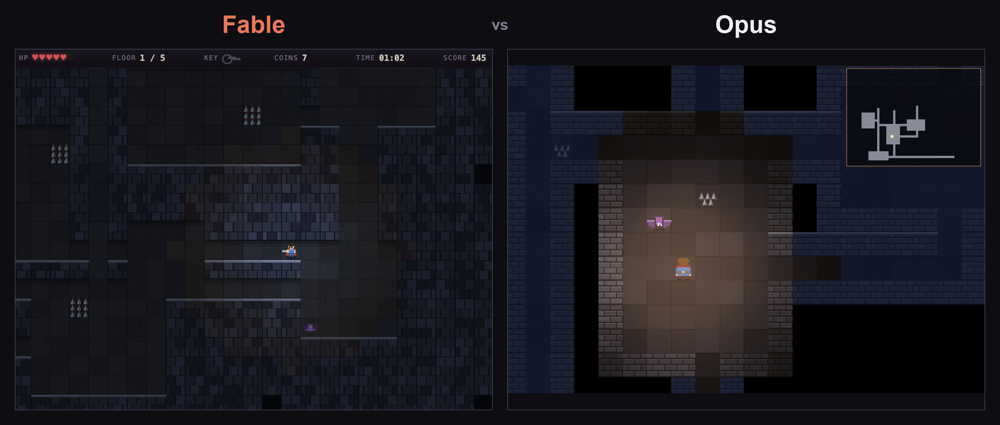

# hobby-experiments

Small hobby experiments.

## Dungeon Escape: Fable vs Opus

Two versions of the same browser game, each built by a different Claude model.

- Play both: https://openvibes.github.io/hobby-experiments/
- Fable version: [dungeon-escape-fable/](dungeon-escape-fable/)
- Opus version: [dungeon-escape-opus/](dungeon-escape-opus/)

Both are plain HTML, CSS and JavaScript with no build step. Open either `index.html` in a browser to play locally.
